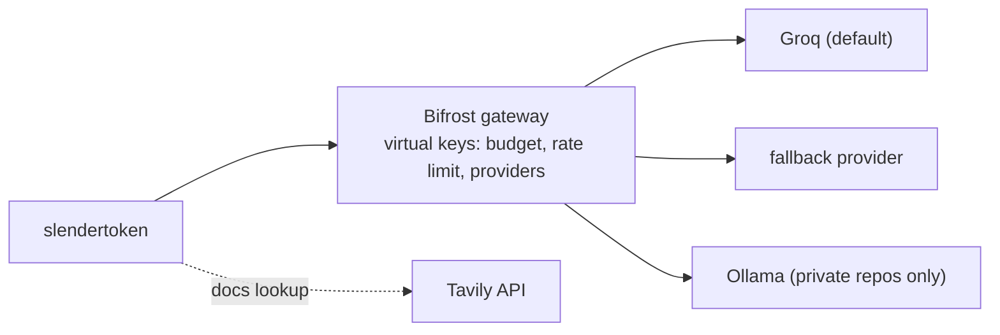
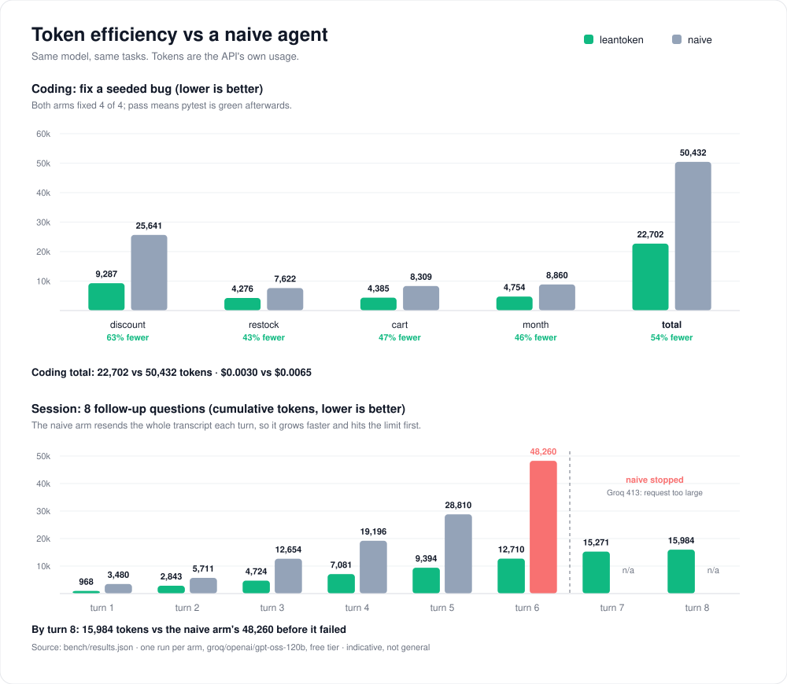

<div align="center">

<pre>
 ███████╗██╗     ███████╗███╗   ██╗██████╗ ███████╗██████╗ ████████╗ ██████╗ ██╗  ██╗███████╗███╗   ██╗
 ██╔════╝██║     ██╔════╝████╗  ██║██╔══██╗██╔════╝██╔══██╗╚══██╔══╝██╔═══██╗██║ ██╔╝██╔════╝████╗  ██║
 ███████╗██║     █████╗  ██╔██╗ ██║██║  ██║█████╗  ██████╔╝   ██║   ██║   ██║█████╔╝ █████╗  ██╔██╗ ██║
 ╚════██║██║     ██╔══╝  ██║╚██╗██║██║  ██║██╔══╝  ██╔══██╗   ██║   ██║   ██║██╔═██╗ ██╔══╝  ██║╚██╗██║
 ███████║███████╗███████╗██║ ╚████║██████╔╝███████╗██║  ██║   ██║   ╚██████╔╝██║  ██╗███████╗██║ ╚████║
 ╚══════╝╚══════╝╚══════╝╚═╝  ╚═══╝╚═════╝ ╚══════╝╚═╝  ╚═╝   ╚═╝    ╚═════╝ ╚═╝  ╚═╝╚══════╝╚═╝  ╚═══╝
</pre>

**A coding agent that finishes real dev tasks on the fewest tokens, and reports what each task cost in money, energy and carbon.**


<sub>Run <code>slendertoken</code> in any folder. It opens a full-screen TUI.</sub>

<a href="https://slendertoken.vercel.app">slendertoken.vercel.app</a>

</div>

Built for the Geek Room Global AI Hackathon, theme: *Build a Coding Agent That Gets the Job Done on the Fewest Tokens*. Every model call goes through the [Bifrost](https://github.com/maximhq/bifrost) gateway.

**Result: 54% fewer tokens than a naive agent across four coding tasks, at the same 4/4 pass rate.** See [Benchmark](#benchmark).

## See it work

While a task runs, a pixel animal tells you what the agent is doing, and the sidebar tracks tokens used against a naive twin of every request, cost, energy and carbon. Edits show as numbered diffs with green and red bands.

<div align="center">

</div>

<div align="center"><sub>thinking &middot; editing &middot; searching &middot; reading &middot; shell &middot; web</sub></div>

**Quick start**

```
curl -fsSL https://raw.githubusercontent.com/Ani07-05/slendertoken/main/install.sh | sh    # macOS / Linux
irm https://raw.githubusercontent.com/Ani07-05/slendertoken/main/install.ps1 | iex         # Windows
```

That one command does everything:

1. Downloads the single `slendertoken` binary for your system and checks its SHA-256 (no Python, Node or Go needed).
2. Runs `slendertoken setup`, which asks for your own [Groq API key](https://console.groq.com/keys) (bring your own key, input hidden).
3. Downloads [Bifrost](https://github.com/maximhq/bifrost), writes its config (Groq provider plus a virtual key with a daily budget), and starts it in the background on a free port.
4. Saves the settings and sends one tiny request through the whole path to prove it works.

Then run `slendertoken` in any repo. Set `GROQ_API_KEY` first to skip the prompt, or `SLENDERTOKEN_NO_SETUP=1` to install only. From source: `go build -o slendertoken ./cmd/slendertoken` (Go 1.22+).

## What it does

- **Fewest tokens.** Ranged file reads instead of whole files, capped search hits, exact-match edits, clipped tool output, old tool results trimmed, a terse prompt and a step limit.
- **Right-sized model.** `gpt-oss-20b` runs first; slendertoken escalates to `gpt-oss-120b` only when a step fails.
- **Survives outages, respects budgets.** Bifrost fails over to a second provider and enforces a per-user budget and rate limit through virtual keys.
- **Private repos.** `--private` uses a key that allows only local Ollama, so Bifrost refuses any cloud call.
- **Safe actions.** Asks before file writes, edits, git actions and any shell command that isn't read-only.
- **Footprint report.** Tokens, cost, latency, energy (kWh) and carbon (gCO2e) per task.
- **Live docs (optional).** A Tavily `web_search` tool; off in private mode and when no key is set.

## Architecture



1. Each step goes to the small model through Bifrost with the user's virtual key.
2. Tools run locally in the repo; anything risky waits for approval.
3. On a failed step (tests fail, bad tool call, repeated error), the rest of the task moves to the large model.
4. Bifrost handles retries, fallbacks and budgets; slendertoken prints the footprint when the task ends.

## Install

Use the one-line installer from [Quick start](#see-it-work), or download a binary from the GitHub releases page (macOS, Linux, Windows; arm64 and amd64) and run `slendertoken setup` yourself.

```
slendertoken setup                 # download Bifrost, configure Groq + budget, start it, test it
slendertoken setup --budget 5      # daily budget in USD on the virtual key (default 2)
slendertoken setup --force         # redo it, for example with a new Groq key
slendertoken bifrost status        # also: start, stop, logs, path
```

Everything lives in `~/.slendertoken`: the Bifrost binary and data in `bifrost/`, your settings in `.env`. The Groq key is stored only in Bifrost's private config file there (mode 600). If the gateway is not running, for example after a reboot, `slendertoken` starts it for you.

Already run your own Bifrost? Skip `setup`: put its URL and virtual key in Settings (`ctrl+s`). For private repos, add Ollama and a second key that allows only Ollama in the Bifrost dashboard.

Settings live in `~/.slendertoken/.env`, so slendertoken works from any folder. A `.env` in the current folder overrides them, and real environment variables override both. `slendertoken config` lists the values in effect and where each comes from (secrets masked); `config set|unset|edit|path` change them; inside the TUI, `/settings` or `ctrl+s` opens the settings page.

**The UI.** A full-screen app on its own near-black background, with a scrolling transcript, a stats sidebar (`ctrl+b` hides it) and a prompt box. The default theme is white and grey; the only color is green and red on added and removed lines, shown as `+N -M` after every edit and task. The pixel animals that play while it works are drawn as real images in Ghostty and kitty; other terminals get a smaller half-block version (`SLENDERTOKEN_IMAGES=0` forces it, `1` forces images). Fonts come from your terminal; slendertoken only uses standard Unicode, no icon fonts. `/theme` switches themes (mono, slender, ember, nord, gruvbox, dracula, paper), `/stats` prints the savings panel, `shift+tab` cycles permission modes, `esc` interrupts a running task, `pgup`/`pgdn` or the mouse wheel scroll, `!cmd` runs a shell command yourself. When a task is ambiguous the agent can ask you a multiple-choice question instead of guessing.

**Web search.** Set `TAVILY_API_KEY` (free tier at app.tavily.com) and the agent gets a `web_search` tool for current docs. Results show as linked sources under the call. Off in private mode.

## Usage

```
slendertoken                      # full-screen TUI: /help, !cmd, ctrl+b sidebar, ctrl+o models, ctrl+s settings
slendertoken "fix the failing test in tests/test_api.py" --repo path/to/repo
slendertoken "add input validation to create_user" --budget 0.50
slendertoken "rename Config to Settings" --private
slendertoken "..." --model groq/openai/gpt-oss-120b --small groq/openai/gpt-oss-20b
slendertoken "..." --no-route     # large model only
```

The small model (`groq/openai/gpt-oss-20b` by default) runs first. slendertoken switches to the large model for the rest of the task when:
- the small model is not done after 8 steps
- 2 tool calls in a row fail
- tests fail twice after an edit
- it says it is done while tests still fail
- Groq rejects its tool call

Each run prints a footprint report and saves it, with a per-step trace, to `<repo>/.slendertoken/runs/`. The TUI also plots tokens saved per turn against a naive twin of each request (whole-file reads, unclipped output, full history); that figure is an estimate for one run, while the benchmark below is the measured comparison.

## Private mode

For repos that must not leave your machine. Private mode runs one local Ollama model through Bifrost, with no Groq, no cloud fallback and no `web_search`. The private virtual key allows only Ollama, so Bifrost refuses any cloud call even if slendertoken asked for one.

```
ollama pull qwen2.5-coder:7b
slendertoken config set BIFROST_PRIVATE_VK <ollama-only key>
slendertoken --private                    # TUI, or add a task for a one-shot run
touch <repo>/.slendertoken-private        # always private in this repo
```

- Model: `qwen2.5-coder:7b` by default; change it with `SLENDERTOKEN_LOCAL_MODEL`.
- Inside the TUI, `/private` toggles it (it refuses to switch on without `BIFROST_PRIVATE_VK`), and the footer and sidebar show the local model.
- Private runs never ask for a Groq key or list Groq models, and cost $0.
- Shell: the agent cannot run common network tools (`curl`, `wget`, `ssh`, `git push`/`fetch`/`clone`, `pip`/`npm install` and similar). This is a best-effort block, not a sandbox: a script can still open a socket, so use an OS-level sandbox if you need a hard guarantee. The model call itself is local by construction.
- Footprint: energy and carbon show as n/a, because the EcoLogits estimate models cloud GPUs and says nothing about your machine. Token savings are still reported.

## Benchmark

Same model (`groq/openai/gpt-oss-120b`), same tasks, same Groq free-tier limits, every call through Bifrost. Token counts are the API's own `usage`. The naive arm uses the same loop and tools but reads whole files, keeps tool output unclipped, never trims history and resends the full transcript on every turn. Reproduce with `.venv/bin/python bench/run.py`; raw numbers are in `bench/results.json`. The chart is generated from those numbers with `.venv/bin/python bench/chart.py`.



**Coding: fix a seeded bug in a small shop library** (pass = `pytest` is green afterwards)

| Task | slendertoken | naive | fewer tokens |
|---|---|---|---|
| discount | 9,287 | 25,641 | 63% |
| restock | 4,276 | 7,622 | 43% |
| cart | 4,385 | 8,309 | 47% |
| month | 4,754 | 8,860 | 46% |
| **total** | **22,702 ($0.0030)** | **50,432 ($0.0065)** | **54%** |

Both arms fixed 4 of 4.

**Session: 8 follow-up questions about the same project**

| After turn | slendertoken (cumulative) | naive (cumulative) |
|---|---|---|
| 1 | 968 | 3,480 |
| 3 | 4,724 | 12,654 |
| 5 | 9,394 | 28,810 |
| 6 | 12,710 | stopped: Groq rejected a 19,450-token request (413) |
| 8 | 15,984 | did not finish |

slendertoken answered 7 of 8 checks. The miss is turn 7: it answered `YYYY-MM`, which is correct, but our keyword check wanted the words "year" and "month"; we kept the check as written. The naive agent answered 5 of 5 before it failed, then could not continue: its transcript outgrew the provider's per-request limit.

Limits: one run per arm, one model, one small synthetic project, free-tier rate limits. On a paid tier the naive agent would not have crashed, it would just have cost more. Treat the percentages as indicative, not general.

## Measurement

Energy uses the [EcoLogits](https://ecologits.ai/latest/methodology/llm_inference/) LLM inference formula: GPU energy from active parameters and output tokens, server energy from request latency, times PUE 1.2. Carbon is energy times the grid intensity of the Groq region that served the call (`X-Groq-Region`; Our World in Data 2023). EcoLogits does not cover Groq and models H100 servers, not Groq LPUs, and it ignores input tokens for GPU energy, so these are comparable estimates, not measurements. Cost uses Groq list prices; Bifrost's logs hold the authoritative cost. A task counts only if its tests pass, and an escalated step is charged for both models.

## Tech

Go, Bubble Tea, Lip Gloss, Glamour, Bifrost, Groq, Ollama, Tavily, EcoLogits. The benchmark in `bench/` still uses the original Python agent.

## AI usage

- Groq-hosted LLMs run the agent; Ollama models run it for private repos.
- Tavily provides live documentation search.
- Claude (Claude Code) helped write the code and documentation. The team reviewed it and is responsible for all of it.
